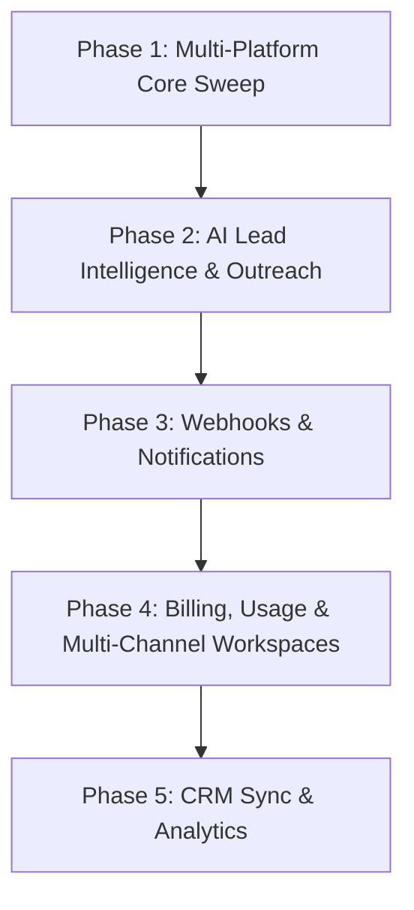

# Echo — Product Requirements Document (PRD)
**Version:** 2.0 (All Phases)  
**Status:** Approved & Implemented  
**Core Stack:** React 19, TypeScript, Tailwind CSS v4, Framer Motion, Supabase (PostgreSQL, Auth, Edge Functions, pg_cron/pg_net), SocialFetch API

---

## 1. Executive Summary & Vision

**Echo** is an automated social lead monitoring and buyer-intent intelligence platform. Echo eliminates the noise of social listening by focusing exclusively on high-precision buyer intent across **X (Twitter)**, **LinkedIn**, **Reddit**, **Facebook**, and **Google Discussions**.

Users specify their company name, website, core offer, and up to **10 target keywords**. Every 24 hours (or at their customized sweep schedule), automated backend jobs sweep public posts, subreddits, groups, and discussions matching these keywords, evaluate intent, and deposit deduplicated lead cards directly into a unified dashboard.

---

## 2. Product Phases & Scope



### Phase 1: Core MVP (Implemented)
- Public Marketing Landing Page with live interactive preview across 5 platforms.
- Authentication with instant sign-in / sign-up (email verification disabled in Supabase).
- 4-Step Animated Onboarding Modal (Name → Website → Core Offer → Keywords pill input with 10 limit & confetti burst).
- Automated Sweeps via Supabase Edge Function (`daily-sweep`) supporting custom execution schedules (06:00, 09:00, 14:00, 18:00 UTC) and cadences (24h, 12h, 6h).
- Unified Feed with multi-platform filtering (**All**, **X**, **LinkedIn**, **Reddit**, **Facebook**, **Google**), channel source tags (e.g. `r/SaaS`, `B2B SaaS Founders`), keyword filtering, search, and pagination.
- Keyword Management with pill input and strict 10-keyword limit enforcement.
- Collapsible responsive sidebar navigation with minimized icon mode.
- Grayscale Scandinavian / Linear-inspired design system (`#f6f6f4`, `#141414`, 58px grid lines).

### Phase 2: AI Lead Intelligence & Outreach Engine (Implemented)
- **AI Keyword Auto-Suggest Engine**: Analyzes user's Core Offer and Website to generate 10 high-intent keywords with zero manual brainstorming.
- **AI Outreach Drafter**: One-click AI response generation with tone selection (*Professional*, *Casual*, *Consultative*, *Direct*), personalized to the post and user's offer.
- **Intent Scoring**: Evaluates posts for buyer intent (0–100%) and categorizes as *High*, *Medium*, or *Low*.
- **Lead Pipeline Status**: Track lead progression through `New`, `Saved`, `Contacted`, and `Dismissed`.

### Phase 3: Notifications, Webhooks & Export (Implemented)
- **Data Export**: One-click export of filtered leads to CSV and JSON for CRM ingestion.
- **Slack & Discord Webhooks**: Instant notification alerts whenever a high-intent (90%+) lead is detected.
- **Daily Email Digest**: Automated summary email dispatched at user's scheduled sweep hour.
- **Inspection Modal**: Deep-dive lead modal showing author follower count, bio, channel source, and raw payload.

### Phase 4: Billing, Plans & Workspace Preferences (Implemented)
- **Subscription Tiers**:
  - *Starter*: 5 keywords, 2 channels (X & Web), daily 24h sweep, $29/month.
  - *Pro* (Popular): 10 keywords, all 5 channels, AI outreach drafts, Slack alerts, $79/month.
  - *Scale*: 25 keywords, all 5 channels, accelerated 6h sweep, unlimited exports, $199/month.
- **Usage Meters**: Active keyword count against the plan limit (e.g. 4/10), mentions found this session, and the configured sweep cadence.
- **Payment**: Stripe-hosted Checkout. A plan is activated server-side only after the `billing` edge function confirms `payment_status === 'paid'`. Card details never touch Echo.
- **Workspace Preferences**: Custom sweep time, lookback window (24h/48h), active channel configuration, minimum intent threshold, and a Slack/Discord webhook.
- **Retired**: the credit-based lead-unlocking system (per-lead credit packs, credit ledger, paywalled contact enrichment) was removed. Feed cards show the author and post directly with no paywall.

### Phase 5: CRM Sync & Enterprise (Roadmap)
- Native two-way integrations with HubSpot, Salesforce, and Attio.
- Multi-seat team workspaces with role-based permissions (Admin, Member, Viewer).
- Webhook dispatch for Zapier and Make.com workflows.

---

## 3. System Architecture & Data Flow

```
[Social & Web Connectors] (X, LinkedIn, Reddit, Facebook Groups, Google Index)
       ▲
       │  HTTP GET multi-platform search queries
       ▼
[Supabase Edge Function: daily-sweep] (Deno TypeScript)
       │  Bypasses RLS with SUPABASE_SERVICE_ROLE_KEY
       │  Deduplicates on (user_id, post_url)
       │  Normalizes payload with channel_source & platform metadata
       ▼
[PostgreSQL Database] (profiles, keywords, monitored_posts, sweep_runs)
       ▲
       │  Client-side queries scoped via RLS (auth.uid() = user_id)
       ▼
[React 19 Frontend App] (Vite + Tailwind CSS v4 + Framer Motion)
```

---

## 4. Complete Database Schema (PostgreSQL)

```sql
-- Extensions
create extension if not exists "pgcrypto";

-- profiles: one row per user, auto-created via auth.users trigger
create table if not exists public.profiles (
  id                     uuid primary key references auth.users(id) on delete cascade,
  full_name              text,
  website                text,
  core_offer             text,
  onboarding_completed   boolean not null default false,
  onboarding_step        smallint not null default 0,
  email_digest           boolean not null default true,
  slack_webhook          text,
  lookback_hours         int not null default 24,
  sweep_time_utc         text not null default '06:00',
  sweep_frequency        text not null default '24h',
  created_at             timestamptz not null default now(),
  updated_at             timestamptz not null default now()
);

alter table public.profiles enable row level security;
create policy "profiles_select_own" on public.profiles for select using (auth.uid() = id);
create policy "profiles_update_own" on public.profiles for update using (auth.uid() = id) with check (auth.uid() = id);

-- keywords: up to 10 active keywords per user (enforced by trigger)
create table if not exists public.keywords (
  id          uuid primary key default gen_random_uuid(),
  user_id     uuid not null references auth.users(id) on delete cascade,
  keyword     text not null,
  is_active   boolean not null default true,
  created_at  timestamptz not null default now(),
  unique (user_id, keyword)
);

create index if not exists idx_keywords_user on public.keywords(user_id) where is_active;
alter table public.keywords enable row level security;
create policy "keywords_all_own" on public.keywords for all using (auth.uid() = user_id) with check (auth.uid() = user_id);

-- Enforce maximum 10 active keywords per user
create or replace function public.enforce_keyword_limit()
returns trigger language plpgsql as $$
declare active_count int;
begin
  if new.is_active then
    select count(*) into active_count from public.keywords
    where user_id = new.user_id and is_active = true and id <> coalesce(new.id, '00000000-0000-0000-0000-000000000000'::uuid);
    if active_count >= 10 then
      raise exception 'Keyword limit reached: a user may have at most 10 active keywords';
    end if;
  end if;
  return new;
end;
$$;

create trigger trg_keyword_limit
  before insert or update on public.keywords
  for each row execute function public.enforce_keyword_limit();

-- monitored_posts: written ONLY by Edge Function (service role)
create table if not exists public.monitored_posts (
  id                uuid primary key default gen_random_uuid(),
  user_id           uuid not null references auth.users(id) on delete cascade,
  keyword_id        uuid references public.keywords(id) on delete set null,
  matched_keyword   text not null,
  platform          text not null check (platform in ('twitter', 'linkedin', 'reddit', 'facebook', 'google')),
  channel_source    text, -- e.g. 'r/SaaS', 'B2B SaaS Founders Group', 'Google Discussions & Forums'
  post_url          text not null,
  author_name       text,
  author_handle     text,
  author_avatar_url text,
  body              text,
  posted_at         timestamptz,
  intent_score      int default 85,
  status            text default 'new' check (status in ('new', 'saved', 'contacted', 'dismissed')),
  engagement        jsonb,
  raw               jsonb,
  created_at        timestamptz not null default now(),
  unique (user_id, post_url)
);

create index if not exists idx_monitored_posts_user_created on public.monitored_posts(user_id, created_at desc);
alter table public.monitored_posts enable row level security;
create policy "monitored_posts_select_own" on public.monitored_posts for select using (auth.uid() = user_id);
create policy "monitored_posts_update_status" on public.monitored_posts for update using (auth.uid() = user_id) with check (auth.uid() = user_id);

-- sweep_runs: audit log for background jobs
create table if not exists public.sweep_runs (
  id               uuid primary key default gen_random_uuid(),
  started_at       timestamptz not null default now(),
  finished_at      timestamptz,
  users_processed  int not null default 0,
  posts_inserted   int not null default 0,
  errors           jsonb not null default '[]'::jsonb
);
alter table public.sweep_runs enable row level security;
```

---

## 5. Daily Sweep Edge Function Specification

- **File:** `supabase/functions/daily-sweep/index.ts`
- **Execution:** Invoked once per day at 06:00 UTC via `pg_cron` or Supabase Edge Function schedule.
- **Security:** Deployed with `--no-verify-jwt`; authenticated via `SUPABASE_SERVICE_ROLE_KEY`.
- **Rate Limit Safety:** Capped at `MAX_PAGES_PER_KEYWORD_PER_PLATFORM = 2` to strictly protect SocialFetch credits.
- **Deduplication:** Postgres upsert with `ON CONFLICT (user_id, post_url) DO NOTHING`.
- **Fault Tolerance:** Individual keyword or platform exceptions are caught and recorded to `sweep_runs.errors` without halting execution for other users.

---

## 6. User Interface & Design System

- **Background:** `#f6f6f4`
- **Grid Texture:** 58px linear-gradient pattern on all content panes.
- **Typography:** Inter / sans-serif with tight tracking (`-0.012em` body, `-0.025em` headings).
- **Corner Radii:** Sharp corners (`rounded-none` or `rounded-xs`) on all panels, buttons, inputs, and cards. Fully rounded (`rounded-full`) exclusively on keyword pills and user avatars.
- **Color Accent Isolation:** Monochrome grayscale throughout the application, except for:
  - **X (Twitter) Badge:** Solid black square (`#000000`) with crisp white SVG.
  - **LinkedIn Badge:** Solid blue square (`#0a66c2`) with crisp white SVG.
  - **Intent & Status Badges:** Emerald green for high intent / active status.

---

## 7. Testing & Verification Guide

1. **Local Development:** Run `npm run dev` and open `http://localhost:5173/`.
2. **Onboarding Flow:** Launch the app, enter Name, Website, Core Offer, add 4 keywords from suggestions, and verify the confetti explosion.
3. **Feed Verification:** Filter by platform (X vs LinkedIn), expand post bodies with "Show more", generate an AI outreach draft, and toggle lead statuses.
4. **Keyword Enforcement:** Add keywords until 10 are active; verify that the input is locked and the warning notice displays.
5. **Settings & Billing:** Configure Webhook URL, adjust lookback window, change subscription tier, and verify usage meters.
