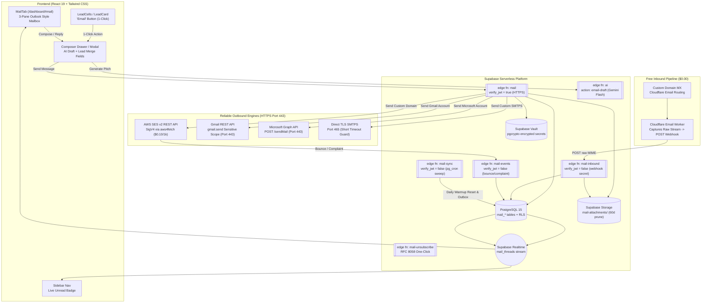

# Echo Mail — Comprehensive Production Plan & Architecture Blueprint
*Cold Outreach Engine, 2-Way Conversational Mailbox & Cost-Optimized Zero-Base Infrastructure*

---

## 1. Executive Summary & Vision

### 1.1 The Core Problem Today
Echo already provides high-accuracy lead discovery with verified work emails (`user_leads.work_email`, `email_status = 'valid'`). However, the only way a user can contact a lead today is through an external `mailto:` link (`src/components/leads/LeadCells.tsx:140`). 
- When users click `mailto:`, they leave Echo to open their local desktop mail client.
- Echo has zero visibility into whether the email was ever sent.
- Echo cannot detect when the lead replies.
- The pipeline stage stays frozen, and the user has to switch between Echo and Gmail/Outlook manually.

### 1.2 The Solution: Dual Outbound Workflow + Central Mailbox Hub
Echo Mail introduces an in-app email subsystem providing two complementary ways to contact leads, both unified under a single **Echo Mailbox**:

```
                                  ┌──────────────────────────────────────────┐
                                  │ Verified Lead Discovered (e.g. Acme Corp)│
                                  └─────────────────────┬────────────────────┘
                                                        │
                         ┌──────────────────────────────┴──────────────────────────────┐
                         ▼                                                             ▼
              [Workflow A: 1-Click Send]                                   [Workflow B: Mailbox Compose]
   User clicks "Email" directly on Lead row/card.              User copies lead email (or searches by name),
   Slide-over Composer Drawer opens with `To:` prefilled.      opens Mail Tab (/dashboard#mail) -> [+ Compose],
   AI drafts personalized pitch in 800ms.                      pastes lead email, and crafts custom email.
                         │                                                             │
                         └──────────────────────────────┬──────────────────────────────┘
                                                        ▼
                                           [Click "Send" in Composer]
                                                        │
                      ┌─────────────────────────────────┴─────────────────────────────────┐
                      ▼                                                                   ▼
          1. Dispatched via Outbound Engine                               2. Persisted in Echo Mailbox
             (AWS SES v2 REST / Gmail API / SMTPS)                           (Stored in 'Sent' folder & Lead linked)
                      │                                                                   │
                      └─────────────────────────────────┬─────────────────────────────────┘
                                                        ▼
                                3. Lead Pipeline Auto-Updated: 'new' ➔ 'contacted'
                                                        │
                                          (When Lead Replies back)
                                                        ▼
                                4. Reply arrives in Echo Mailbox 'Inbox'
                                   - Threaded automatically under the same conversation
                                   - Auto-responder & OOO detection prevents false upgrades
                                   - Realtime unread count updates in sidebar
                                   - Lead Pipeline Auto-Updated: 'contacted' ➔ 'replied'!
```

---

## 2. Infrastructure Cost Analysis: Zero-Base Cost Strategy

Most email SaaS platforms charge $30–$80/month fixed subscriptions. Echo Mail is engineered to run on a **true pay-as-you-go serverless architecture with $0.00 monthly baseline fees**:

| Architectural Component | Expensive Standard Approach | **Echo Budget-Optimized Architecture** | Monthly Base Cost | Unit Cost |
|---|---|---|---|---|
| **Outbound Email Engine** | SendGrid / Postmark ($15–$35/mo base) | **AWS SES v2** (Primary) + **Brevo Free Tier** (Fallback) | **$0.00** | $0.10 per 1,000 emails ($0.0001/email) |
| **Inbound Email Pipeline** | AWS SES Inbound + S3 Bucket + SNS Topics | **Cloudflare Email Routing + Cloudflare Worker** | **$0.00** | 100% Free (100k requests/day free on Cloudflare) |
| **Connected Mailbox (Gmail)** | Google OAuth with `gmail.modify` (Restricted Scope) | **Universal IMAP/SMTP with App Passwords** OR **Google OAuth (`gmail.send` Sensitive only)** | **$0.00** | **Saves $1,500 – $4,500 / year** (Bypasses Google CASA lab audits!) |
| **Connected Mailbox (Outlook / Zoho)** | Custom Enterprise Graph APIs | **Direct TLS IMAP/SMTP** with credentials in Supabase Vault | **$0.00** | $0.00 platform cost (Uses user's existing mailbox) |
| **AI Cold Email Drafting** | GPT-4o ($5.00 – $10.00 / 1M tokens) | **Google Gemini 2.0 Flash / 1.5 Flash** | **$0.00** | $0.075 / 1M tokens (~$0.000026 per email draft) |
| **Email Body & MIME Storage** | Uncapped dedicated storage | **Supabase Postgres (Text) + Supabase Storage** (1GB Free) | **$0.00** | Covered under Supabase Free Tier with 60-day prune |
| **Total Platform Fixed Fee** | ~$150 – $400/mo + $1,500+/yr audit | **Echo Serverless Mail Stack** | **$0.00 / mo** | **Pay strictly for actual sends (~$0.0001/send)** |

---

## 3. Deep Problem Analysis & Production Edge-Cases (Post-Mortem & Prevention)

Building production email infrastructure involves critical pitfalls that cause silent failures, banned accounts, and broken user data. Below is the deep research and architectural solution for the top 10 failure points:

### 🚨 Problem 1: Serverless Edge Functions Block Raw SMTP Ports (Port 25, 587)
- **The Pitfall:** Supabase Edge Functions execute in a Deno-based distributed serverless sandbox. Cloud providers heavily restrict or outright block outbound raw TCP traffic on port 25 and port 587 (STARTTLS) to prevent rogue botnets from spamming. Furthermore, STARTTLS connection upgrade handshakes frequently timeout in serverless runtimes.
- **Production Solution:**
  1. **Primary Outbound:** We use **HTTPS REST APIs (Port 443)** for all major providers:
     - **AWS SES v2:** Direct REST calls via `aws4fetch` SigV4 over HTTPS (Port 443). 100% reliable in Deno.
     - **Google / Gmail:** Google's **Gmail REST API** (`https://gmail.googleapis.com/upload/gmail/v1/users/me/messages/send`) over standard HTTPS (Port 443).
     - **Microsoft 365:** **Microsoft Graph API** (`https://graph.microsoft.com/v1.0/me/sendMail`) over standard HTTPS (Port 443).
     - **Brevo Fallback:** Brevo v3 REST API over HTTPS (Port 443).
  2. **Custom SMTP Fallback:** For generic custom mail servers, use direct TLS on **Port 465 (SMTPS)** with `Deno.connectTls` and strict 8-second connection timeouts, avoiding unencrypted STARTTLS upgrades.

### 🚨 Problem 2: False-Positive Lead Upgrades (Out-of-Office, Auto-Replies & Bounces)
- **The Pitfall:** If every incoming email is treated as a genuine lead reply, Out-of-Office (OOO) messages, "I am on vacation", "Delivery Status Notification (Failure)", and auto-acknowledgments will automatically move the lead to `replied`, polluting the sales pipeline with false positives.
- **Production Solution (RFC 3834 Filter Engine):**
  Incoming emails in `mail-inbound` pass through an automated classification check before updating lead status:
  1. **Header Checks:** Drop/tag if `Auto-Submitted` exists and !== `'no'`, or if headers contain `X-Autoreply`, `X-Auto-Response-Suppress`, or `Precedence: bulk | junk | auto_reply`.
  2. **Sender Checks:** If sender starts with `mailer-daemon@`, `postmaster@`, or contains `noreply`, classify as automated.
  3. **Content Heuristics:** Fast regex scan on subject and first 200 characters of body for keywords (`out of office`, `automatic reply`, `away from my desk`, `undelivered mail`, `delivery status notification`).
  4. **Outcome:**
     - **Genuine Reply:** Threaded into Inbox, unread badge increments, `user_leads.pipeline_stage = 'replied'`.
     - **Auto-Reply (OOO):** Threaded into Inbox, tagged with badge `[Auto-Reply]`, **`user_leads.pipeline_stage` remains `contacted`**.
     - **Hard Bounce:** Message marked `bounced`, lead marked `bounced`, email added to `mail_suppressions`.

### 🚨 Problem 3: Broken Thread Matching (Subject Changes, Aliases & Stripped Headers)
- **The Pitfall:** When a lead replies, their mail client might strip `In-Reply-To` and `References` headers, change the subject (e.g. from *"Quick question about Acme"* to *"Re: Pricing details"*), or the lead might reply from an alias (e.g. sent to `john@acmecorp.com`, but reply arrives from `john.smith@gmail.com`).
- **Production Solution (4-Tier Thread Matching Algorithm):**
  ```
  Step 1: Check RFC 5322 In-Reply-To / References against mail_messages.message_id_header. (Matches 92% of replies)
     ↓ (If not found)
  Step 2: Check X-Echo-Thread-ID header (Echo injects this tracking header into every outbound send).
     ↓ (If stripped by recipient client)
  Step 3: Normalized Subject Match: Strip 'Re:', 'Fwd:', whitespace, and match against threads with same recipient within 30 days.
     ↓ (If subject was completely changed)
  Step 4: Domain & Participant Fallback: Match sender domain against active lead company domain (lead.company_domain) within 14 days.
  ```

### 🚨 Problem 4: Domain MX Conflict (The "Don't Break Company Email" Rule)
- **The Pitfall:** If a user inputs their primary domain `acme.com` (which already receives mail on Google Workspace or M365) and changes MX records to Echo, **all existing company emails stop working immediately**.
- **Production Solution:**
  1. During domain setup (`domains.add`), the edge function performs an automated DNS pre-flight check via Cloudflare/Google DNS-over-HTTPS.
  2. If existing MX records are detected (e.g. `aspmx.l.google.com` or `mail.protection.outlook.com`):
     - Setting up root domain MX is **hard-blocked**.
     - Echo displays an educational prompt: *"Your domain already receives email via Google Workspace. To protect your company email, either connect your Google account directly (Method B) OR use a dedicated outreach subdomain like `mail.acme.com` or `tryacme.com`."*

### 🚨 Problem 5: The Google CASA Audit Trap ($1,500 – $4,500/year)
- **The Pitfall:** If an application requests Google OAuth restricted scopes (`gmail.modify` or `gmail.readonly`) to read user emails, Google mandates a yearly Cloud Application Security Assessment (CASA) Tier 2/3 audit conducted by an authorized security lab (Bishop Fox, NCC, Leviathan). This takes 6–8 weeks and costs between $1,500 and $4,500 every single year.
- **Production Solution:**
  - **Method 1 (Primary): Universal App Passwords via TLS SMTPS:**
    - Cost: **$0.00**. No Google verification required, no CASA audit, no 100-user limit.
    - User creates an App Password in Google/Microsoft security settings and enters it into Echo.
    - Password is encrypted with `pgcrypto` in Supabase Vault (`store_mailbox_secret`).
  - **Method 2 (OAuth Alternative): Sensitive Scope ONLY (`gmail.send`):**
    - `https://www.googleapis.com/auth/gmail.send` is categorized as **Sensitive**, NOT Restricted!
    - Sensitive scopes require only basic Google brand verification and **DO NOT require a third-party CASA lab audit**.

### 🚨 Problem 6: Idempotency & Double-Click Protection
- **The Pitfall:** If a user double-clicks "Send" or their mobile network retries a slow POST request, the lead receives two duplicate emails, the user is charged double credits, and the lead marks the email as spam.
- **Production Solution:**
  1. The client generates a unique UUID `client_message_id = crypto.randomUUID()`.
  2. The idempotency key `mail:${client_message_id}` is passed to `wallet_reserve`.
  3. If a duplicate request arrives, `wallet_reserve` detects the existing reservation and returns `{ duplicate: true }`, short-circuiting the edge function without dispatching a duplicate email.

### 🚨 Problem 7: XSS, CSS Overlay Injection & Privacy Leaks in Incoming HTML
- **The Pitfall:** Cold outreach inboxes receive emails containing malicious `<script>` tags, CSS overlay injection (`position:fixed; width:100vw; height:100vh;` clickjacking overlays), or covert 1x1 tracking pixels that leak the user's IP and location.
- **Production Solution (3-Layer Security Shield):**
  1. **Sanitization:** All HTML bodies are passed through `DOMPurify` before rendering, stripping `<script>`, `<object>`, `<embed>`, inline JS (`onload`, `onerror`), and dangerous CSS properties (`position:fixed`, `z-index:999999`).
  2. **Sandboxed Iframe:** Rendered inside `<iframe sandbox="allow-popups allow-popups-to-escape-sandbox" srcdoc={cleanHtml}>`. Scripts and same-origin cookies/localStorage access are strictly forbidden.
  3. **Privacy Shield:** Remote `` tags are blocked by default and replaced with an inline placeholder. Users click "Show remote images" to load external assets on demand.

### 🚨 Problem 8: Storage Quota Exhaustion (Supabase 1GB Free Storage Limit)
- **The Pitfall:** Large attachments (e.g. 20MB PDFs) will rapidly exhaust Supabase's 1GB free storage tier within weeks.
- **Production Solution:**
  1. **Strict Outbound Limit:** Maximum 10MB per attachment (sales cold emails should never be bloated with giant files).
  2. **Raw MIME Discard:** After extracting plain text, clean HTML, and valid attachments, the raw MIME string is discarded rather than stored permanently in Postgres.
  3. **60-Day Retention Policy:** Storage objects in `mail-attachments/` older than 60 days are automatically pruned via `pg_cron` sweep.

### 🚨 Problem 9: Missing Template Merge Tags (The "Hi {{first_name}}" Disaster)
- **The Pitfall:** If a lead row does not have a verified first name or company name, standard template interpolation produces embarrassing emails like *"Hi , I saw you are at ."*
- **Production Solution (Smart Fallback Interpolator):**
  The template engine enforces default fallback values:
  - `{{first_name|there}}` -> Outputs `"there"` if `first_name` is empty (e.g. *"Hi there"*).
  - `{{company|your company}}` -> Outputs `"your company"` if `company` is null.
  - Client-side composer alerts the user with an inline badge if any merge tag cannot be resolved before sending.

### 🚨 Problem 10: 2024 Google & Yahoo Bulk Sender Enforcement
- **The Pitfall:** In 2024, Google and Yahoo enforce strict deliverability requirements. If spam complaints exceed **0.3%** or DMARC/DKIM/SPF are misconfigured, emails land directly in the spam folder or get rejected.
- **Production Solution:**
  - Automated DNS verification ensures DKIM 2048-bit, SPF, and DMARC (`p=none` to start) are active before sending is unlocked.
  - Every outreach email carries RFC 8058 one-click unsubscribe headers (`List-Unsubscribe` + `List-Unsubscribe-Post: List-Unsubscribe=One-Click`).
  - Automatic circuit breaker: If mailbox bounce rate exceeds **4.0%** or complaint rate exceeds **0.1%**, the mailbox is paused automatically.

---

## 4. High-Level Architecture Diagram



---

## 5. Complete Database Schema (`supabase/migrations/20261125_mail.sql`)

### 5.1 Full Production SQL Migration

```sql
-- ============================================================================
-- Migration: 20261125_mail.sql
-- Description: Complete schema for Echo Mail (Domains, Mailboxes, Threads, Messages)
-- ============================================================================

-- 1. Custom & Outreach Domains
CREATE TABLE public.mail_domains (
  id UUID PRIMARY KEY DEFAULT gen_random_uuid(),
  user_id UUID NOT NULL REFERENCES auth.users(id) ON DELETE CASCADE,
  domain TEXT NOT NULL,
  status TEXT NOT NULL DEFAULT 'pending' CHECK (status IN ('pending', 'verifying', 'verified', 'failed', 'suspended')),
  provider TEXT NOT NULL DEFAULT 'ses' CHECK (provider IN ('ses', 'brevo', 'custom')),
  dkim_tokens JSONB DEFAULT '[]'::jsonb,
  dns_records JSONB DEFAULT '[]'::jsonb,
  inbound_provider TEXT NOT NULL DEFAULT 'cloudflare' CHECK (inbound_provider IN ('cloudflare', 'ses', 'none')),
  inbound_enabled BOOLEAN NOT NULL DEFAULT true,
  existing_mx JSONB DEFAULT '[]'::jsonb,
  verified_at TIMESTAMPTZ,
  last_checked_at TIMESTAMPTZ,
  created_at TIMESTAMPTZ NOT NULL DEFAULT now(),
  CONSTRAINT uq_mail_domains_user_domain UNIQUE (user_id, domain)
);
CREATE INDEX idx_mail_domains_user_id ON public.mail_domains(user_id);

-- 2. Mailboxes (Hosted, App Password, or OAuth)
CREATE TABLE public.mailboxes (
  id UUID PRIMARY KEY DEFAULT gen_random_uuid(),
  user_id UUID NOT NULL REFERENCES auth.users(id) ON DELETE CASCADE,
  kind TEXT NOT NULL CHECK (kind IN ('hosted', 'app_password', 'oauth_send')),
  provider TEXT NOT NULL DEFAULT 'custom' CHECK (provider IN ('google', 'microsoft', 'zoho', 'ses', 'brevo', 'custom')),
  address TEXT NOT NULL,
  display_name TEXT NOT NULL,
  domain_id UUID REFERENCES public.mail_domains(id) ON DELETE SET NULL,
  signature_html TEXT DEFAULT '',
  status TEXT NOT NULL DEFAULT 'active' CHECK (status IN ('active', 'paused', 'needs_reauth', 'disabled')),
  pause_reason TEXT,
  
  -- SMTP & IMAP credentials
  smtp_host TEXT,
  smtp_port INT DEFAULT 465,
  imap_host TEXT,
  imap_port INT DEFAULT 993,
  vault_secret_id UUID, -- References encrypted secret in Supabase Vault
  
  -- Warm-up and Rate Limiting
  daily_send_limit INT NOT NULL DEFAULT 20,
  warmup_day INT NOT NULL DEFAULT 1,
  sent_today INT NOT NULL DEFAULT 0,
  sent_today_date DATE NOT NULL DEFAULT CURRENT_DATE,
  
  is_default BOOLEAN NOT NULL DEFAULT false,
  last_synced_at TIMESTAMPTZ,
  created_at TIMESTAMPTZ NOT NULL DEFAULT now(),
  CONSTRAINT uq_mailboxes_user_address UNIQUE (user_id, address)
);
CREATE INDEX idx_mailboxes_user_id ON public.mailboxes(user_id);

-- 3. Conversation Threads
CREATE TABLE public.mail_threads (
  id UUID PRIMARY KEY DEFAULT gen_random_uuid(),
  user_id UUID NOT NULL REFERENCES auth.users(id) ON DELETE CASCADE,
  mailbox_id UUID NOT NULL REFERENCES public.mailboxes(id) ON DELETE CASCADE,
  lead_id UUID REFERENCES public.user_leads(id) ON DELETE SET NULL,
  subject TEXT NOT NULL DEFAULT '(No Subject)',
  normalized_subject TEXT NOT NULL DEFAULT '',
  snippet TEXT NOT NULL DEFAULT '',
  participants JSONB NOT NULL DEFAULT '[]'::jsonb,
  folder TEXT NOT NULL DEFAULT 'inbox' CHECK (folder IN ('inbox', 'sent', 'drafts', 'archive', 'trash', 'spam')),
  unread_count INT NOT NULL DEFAULT 0,
  starred BOOLEAN NOT NULL DEFAULT false,
  has_attachments BOOLEAN NOT NULL DEFAULT false,
  last_message_at TIMESTAMPTZ NOT NULL DEFAULT now(),
  created_at TIMESTAMPTZ NOT NULL DEFAULT now()
);
CREATE INDEX idx_mail_threads_user_folder ON public.mail_threads(user_id, mailbox_id, folder, last_message_at DESC);
CREATE INDEX idx_mail_threads_lead_id ON public.mail_threads(lead_id);
CREATE INDEX idx_mail_threads_normalized_subject ON public.mail_threads(user_id, normalized_subject);
CREATE INDEX idx_mail_threads_search ON public.mail_threads USING gin(to_tsvector('english', subject || ' ' || snippet));

-- 4. Messages (Inbound & Outbound)
CREATE TABLE public.mail_messages (
  id UUID PRIMARY KEY DEFAULT gen_random_uuid(),
  thread_id UUID NOT NULL REFERENCES public.mail_threads(id) ON DELETE CASCADE,
  user_id UUID NOT NULL REFERENCES auth.users(id) ON DELETE CASCADE,
  mailbox_id UUID NOT NULL REFERENCES public.mailboxes(id) ON DELETE CASCADE,
  lead_id UUID REFERENCES public.user_leads(id) ON DELETE SET NULL,
  direction TEXT NOT NULL CHECK (direction IN ('in', 'out')),
  status TEXT NOT NULL DEFAULT 'sent' CHECK (status IN ('draft', 'queued', 'sending', 'sent', 'delivered', 'bounced', 'complained', 'failed', 'received')),
  is_auto_reply BOOLEAN NOT NULL DEFAULT false,
  from_addr TEXT NOT NULL,
  to_addrs JSONB NOT NULL DEFAULT '[]'::jsonb,
  cc_addrs JSONB NOT NULL DEFAULT '[]'::jsonb,
  bcc_addrs JSONB NOT NULL DEFAULT '[]'::jsonb,
  subject TEXT NOT NULL DEFAULT '',
  snippet TEXT NOT NULL DEFAULT '',
  text_body TEXT NOT NULL DEFAULT '',
  html_body TEXT NOT NULL DEFAULT '',
  message_id_header TEXT UNIQUE,
  in_reply_to TEXT,
  references_hdr TEXT,
  credits_charged NUMERIC(10, 4) NOT NULL DEFAULT 0,
  error_message TEXT,
  sent_at TIMESTAMPTZ,
  received_at TIMESTAMPTZ,
  read_at TIMESTAMPTZ,
  created_at TIMESTAMPTZ NOT NULL DEFAULT now()
);
CREATE INDEX idx_mail_messages_thread_id ON public.mail_messages(thread_id, created_at ASC);
CREATE INDEX idx_mail_messages_message_id_header ON public.mail_messages(message_id_header);
CREATE INDEX idx_mail_messages_lead_id ON public.mail_messages(lead_id);

-- 5. Attachments
CREATE TABLE public.mail_attachments (
  id UUID PRIMARY KEY DEFAULT gen_random_uuid(),
  message_id UUID NOT NULL REFERENCES public.mail_messages(id) ON DELETE CASCADE,
  user_id UUID NOT NULL REFERENCES auth.users(id) ON DELETE CASCADE,
  filename TEXT NOT NULL,
  content_type TEXT NOT NULL,
  size_bytes BIGINT NOT NULL,
  storage_path TEXT NOT NULL,
  created_at TIMESTAMPTZ NOT NULL DEFAULT now()
);
CREATE INDEX idx_mail_attachments_user_id ON public.mail_attachments(user_id);

-- 6. Events Log (Bounces, Complaints, Deliveries)
CREATE TABLE public.mail_events (
  id UUID PRIMARY KEY DEFAULT gen_random_uuid(),
  message_id UUID REFERENCES public.mail_messages(id) ON DELETE SET NULL,
  user_id UUID REFERENCES auth.users(id) ON DELETE CASCADE,
  type TEXT NOT NULL CHECK (type IN ('send', 'delivery', 'bounce', 'complaint', 'reject')),
  payload JSONB NOT NULL DEFAULT '{}'::jsonb,
  occurred_at TIMESTAMPTZ NOT NULL DEFAULT now()
);
CREATE INDEX idx_mail_events_user_occurred ON public.mail_events(user_id, occurred_at DESC);

-- 7. Suppression List
CREATE TABLE public.mail_suppressions (
  id UUID PRIMARY KEY DEFAULT gen_random_uuid(),
  user_id UUID REFERENCES auth.users(id) ON DELETE CASCADE, -- NULL = global suppression
  email TEXT NOT NULL,
  reason TEXT NOT NULL CHECK (reason IN ('hard_bounce', 'complaint', 'unsubscribe', 'manual')),
  created_at TIMESTAMPTZ NOT NULL DEFAULT now(),
  CONSTRAINT uq_mail_suppressions UNIQUE (user_id, email)
);
CREATE INDEX idx_mail_suppressions_email ON public.mail_suppressions(lower(email));

-- 8. Background Outbox Queue
CREATE TABLE public.mail_outbox (
  id UUID PRIMARY KEY DEFAULT gen_random_uuid(),
  user_id UUID NOT NULL REFERENCES auth.users(id) ON DELETE CASCADE,
  mailbox_id UUID NOT NULL REFERENCES public.mailboxes(id) ON DELETE CASCADE,
  message_id UUID NOT NULL REFERENCES public.mail_messages(id) ON DELETE CASCADE,
  not_before TIMESTAMPTZ NOT NULL DEFAULT now(),
  attempts INT NOT NULL DEFAULT 0,
  last_error TEXT,
  locked_until TIMESTAMPTZ,
  created_at TIMESTAMPTZ NOT NULL DEFAULT now()
);
CREATE INDEX idx_mail_outbox_queue ON public.mail_outbox(not_before, locked_until) WHERE attempts < 5;

-- 9. Enable Row-Level Security (RLS)
ALTER TABLE public.mail_domains ENABLE ROW LEVEL SECURITY;
ALTER TABLE public.mailboxes ENABLE ROW LEVEL SECURITY;
ALTER TABLE public.mail_threads ENABLE ROW LEVEL SECURITY;
ALTER TABLE public.mail_messages ENABLE ROW LEVEL SECURITY;
ALTER TABLE public.mail_attachments ENABLE ROW LEVEL SECURITY;
ALTER TABLE public.mail_events ENABLE ROW LEVEL SECURITY;
ALTER TABLE public.mail_suppressions ENABLE ROW LEVEL SECURITY;
ALTER TABLE public.mail_outbox ENABLE ROW LEVEL SECURITY;

REVOKE ALL ON ALL TABLES IN SCHEMA public FROM anon;

CREATE POLICY "Users view own mail_domains" ON public.mail_domains FOR SELECT TO authenticated USING (auth.uid() = user_id);
CREATE POLICY "Users view own mailboxes" ON public.mailboxes FOR SELECT TO authenticated USING (auth.uid() = user_id);
CREATE POLICY "Users view own mail_threads" ON public.mail_threads FOR SELECT TO authenticated USING (auth.uid() = user_id);
CREATE POLICY "Users view own mail_messages" ON public.mail_messages FOR SELECT TO authenticated USING (auth.uid() = user_id);
CREATE POLICY "Users view own mail_attachments" ON public.mail_attachments FOR SELECT TO authenticated USING (auth.uid() = user_id);

CREATE POLICY "Users update own threads" ON public.mail_threads FOR UPDATE TO authenticated 
USING (auth.uid() = user_id) 
WITH CHECK (auth.uid() = user_id);

-- 10. Vault Secret Helpers
CREATE OR REPLACE FUNCTION public.store_mailbox_secret(p_secret TEXT)
RETURNS UUID
LANGUAGE plpgsql
SECURITY DEFINER
SET search_path = public, vault
AS $$
DECLARE
  v_secret_id UUID;
BEGIN
  v_secret_id := vault.create_secret(p_secret);
  RETURN v_secret_id;
END;
$$;

CREATE OR REPLACE FUNCTION public.get_mailbox_secret(p_secret_id UUID)
RETURNS TEXT
LANGUAGE plpgsql
SECURITY DEFINER
SET search_path = public, vault
AS $$
DECLARE
  v_secret TEXT;
BEGIN
  SELECT decrypted_secret INTO v_secret 
  FROM vault.decrypted_secrets 
  WHERE id = p_secret_id;
  RETURN v_secret;
END;
$$;

REVOKE ALL ON FUNCTION public.store_mailbox_secret FROM public, anon, authenticated;
REVOKE ALL ON FUNCTION public.get_mailbox_secret FROM public, anon, authenticated;
GRANT EXECUTE ON FUNCTION public.store_mailbox_secret TO service_role;
GRANT EXECUTE ON FUNCTION public.get_mailbox_secret TO service_role;

-- 11. Pricing Configuration Rows
INSERT INTO public.pricing_config (operation, credits, provider_cost_usd, description)
VALUES 
  ('mail.send', 0.1, 0.00010, 'Outbound email send via Echo SES infrastructure (10 emails per credit)'),
  ('mail.send.connected', 0.05, 0.00000, 'Outbound email send via user connected Gmail/Outlook mailbox'),
  ('mail.receive', 0.0, 0.00000, 'Inbound email received and threaded into mailbox (Free)')
ON CONFLICT (operation) DO UPDATE 
SET credits = EXCLUDED.credits, provider_cost_usd = EXCLUDED.provider_cost_usd;

-- 12. Realtime Publication
ALTER PUBLICATION supabase_realtime ADD TABLE public.mail_threads;
```

---

## 6. Edge Functions Implementation & Specs

### 6.1 `mail` Edge Function (`supabase/functions/mail/index.ts`)
Handles authenticated user requests:
- `action === 'send'`:
  1. Validates `to`, `subject`, `body_html`, `mailbox_id`.
  2. Runs suppression check (`mail_suppressions`).
  3. Checks daily warmup limit (`sent_today < daily_send_limit`).
  4. Calls `wallet_reserve` (0.1 credit for SES, 0.05 for connected account).
  5. If hosted mailbox: calls AWS SES v2 `SendEmail` with custom `Message-ID` and `List-Unsubscribe` headers.
  6. If app_password mailbox: retrieves secret from Vault, connects via SMTPS over TLS (port 465) or Gmail REST API.
  7. On success: calls `wallet_settle`, updates `user_leads.pipeline_stage = 'contacted'`, inserts message into `mail_messages` (folder: `sent`).
  8. If duplicate request arrives: returns `{ duplicate: true }` without re-sending.

### 6.2 `mail-inbound` Edge Function (`supabase/functions/mail-inbound/index.ts`)
Handles raw email webhooks from Cloudflare Email Worker:
1. Validates `x-webhook-secret` header.
2. Parses raw MIME payload using `postal-mime`.
3. Runs **RFC 3834 Auto-Responder & OOO Filter**:
   - If `Auto-Submitted` !== `'no'` or OOO keywords detected, tags message with `is_auto_reply = true`.
4. Executes **4-Tier Thread Matching Engine**:
   - Matches `In-Reply-To` / `References` headers.
   - If missing, checks `X-Echo-Thread-ID` tracking header.
   - If missing, checks normalized subject + recipient pair within 30 days.
   - If still missing, creates a clean new thread.
5. Saves clean HTML & text body, uploads attachments to `mail-attachments/` bucket.
6. **Lead Pipeline Progression:**
   - If message is NOT an auto-reply, and sender matches a contacted lead:
     - Automatically updates `user_leads.pipeline_stage = 'replied'`!
7. Realtime broadcast notifies the user's browser, updating unread badges instantly.

### 6.3 `ai` Edge Function (`supabase/functions/ai/index.ts`)
Action: `email-draft`
- **Model:** `gemini-2.0-flash` (or `gemini-1.5-flash`).
- **Input:** `{ lead: { first_name, company, title }, tone, offer, my_name }`.
- **System Prompt:**
  ```text
  You are an expert sales development representative writing a high-converting, personalized B2B cold email.
  Lead Name: {{first_name}}
  Company: {{company}}
  Title: {{title}}
  Offer: {{offer}}
  Tone: {{tone}} (Casual / Direct / Value-first)
  Rules:
  1. Keep the subject line under 7 words, compelling and curiosity-inducing.
  2. Keep the email body between 60 to 110 words.
  3. Focus on a specific pain point relevant to their role and offer a low-friction call to action (e.g. "Open to exploring?").
  4. Output JSON format: { "subject": "...", "body": "..." }
  ```
- **Cost:** ~$0.000026 per execution (<$0.01 per 1,000 drafts).

---

## 7. Cloudflare Inbound Worker Script

Deploy this lightweight Cloudflare Worker (100% Free, 100k requests/day free tier) to route emails into Supabase:

```javascript
export default {
  async email(message, env, ctx) {
    const sender = message.from;
    const recipient = message.to;
    const subject = message.headers.get("subject") || "";
    
    // Read raw MIME stream
    const rawEmail = await new Response(message.raw).text();

    // Forward payload to Supabase mail-inbound Edge Function
    const response = await fetch(`${env.SUPABASE_URL}/functions/v1/mail-inbound`, {
      method: "POST",
      headers: {
        "Content-Type": "application/json",
        "x-webhook-secret": env.CF_INBOUND_SECRET,
      },
      body: JSON.stringify({
        from: sender,
        to: recipient,
        subject: subject,
        raw_mime: rawEmail,
      }),
    });

    if (!response.ok) {
      console.error(`Failed to post inbound email: ${response.statusText}`);
    }
  }
};
```

---

## 8. Frontend Component Specs (`src/components/mail/`)

```
src/components/mail/
├── MailTab.tsx              # Full-bleed 3-pane shell matching LeadsTab. Sub-views: Mailbox / Domains / Settings
├── MailSidebar.tsx           # Account dropdown, folders (Inbox, Sent, Drafts, Archive, Trash) with Realtime counts
├── ThreadList.tsx            # Virtualized list of conversation threads with search & lead status chips
├── ThreadView.tsx            # Message timeline, lead banner ('Lead: Contacted -> Replied'), inline reply composer
├── MessageBody.tsx           # Sandboxed iframe + DOMPurify sanitization + "Show remote images" button
├── Composer.tsx              # Reusable Drawer & Modal with AI draft pills, merge tag menu & wallet cost line
├── DomainsPanel.tsx          # Custom outreach domain verification cards with copy-paste DNS records
├── AccountsPanel.tsx         # Connect Mailbox modal (App Passwords for Gmail/M365/Zoho with TLS verification)
└── lead-autocomplete.tsx     # Smart lead search dropdown for Composer "To:" input
```

### Lead Table & Card Integration Points
- **`src/components/leads/LeadCells.tsx` (EmailCell):**
  Render an **"Email"** button next to the email address:
  - Clicking triggers `openComposer({ leadId: lead.id, to: lead.work_email, name: lead.first_name, company: lead.company })`.
  - Next to it, the `CopyButton` remains for users who prefer copying the address manually.
- **`src/components/leads/LeadCard.tsx` & `ResultsPanel.tsx`:**
  - When `lead.pipeline_status === 'contacted'`, display chip: `● Contacted (View thread)`.
  - When `lead.pipeline_status === 'replied'`, display chip: `★ Replied (View thread)`.
  - Clicking `View thread` automatically switches active tab to `'mail'` and selects that conversation!

---

## 9. Phased Execution Roadmap

### Phase 1: Database Migration & Core Outbound Engine (Week 1)
- Apply migration `20261125_mail.sql` (tables, RLS, Vault functions, pricing config).
- Deploy `mail` Edge Function supporting `action === 'send'` via AWS SES v2 REST API.
- Add `email-draft` action to `ai` Edge Function (Gemini 2.0 Flash).
- Implement `Composer.tsx` drawer and replace `mailto:` in `LeadCells.tsx` with **"Email"** button.
- Verify 1-click send, wallet deduction (0.1 credit), and lead status updating to `contacted`.

### Phase 2: Free Inbound Pipeline & 3-Pane Mailbox UI (Week 2)
- Configure Cloudflare Email Routing & deploy Cloudflare Email Worker.
- Implement `mail-inbound` Edge Function with `postal-mime` parsing and RFC 3834 auto-reply detection.
- Build 3-pane Mailbox UI (`MailTab.tsx`, `MailSidebar.tsx`, `ThreadList.tsx`, `ThreadView.tsx`).
- Wire Supabase Realtime so new replies trigger instant inbox badges and update lead status to `replied`.
- Add manual compose with lead auto-complete from the Mailbox tab.

### Phase 3: Connected Accounts & Custom Outreach Domains (Week 3)
- Build `DomainsPanel.tsx` with DNS copy cards (DKIM, SPF, DMARC, Cloudflare MX).
- Implement App Password connector in `AccountsPanel.tsx` with automated SMTPS TLS test.
- Integrate Supabase Vault for encrypted credential storage.
- Implement `mail-events` Edge Function for SES bounce and complaint handling with auto-pausing.

### Phase 4: Deliverability Polish & Bulk Outreach (Week 4)
- Implement `mail-sync` pg_cron job (daily warmup counter increment, outbox runner).
- Implement `mail-unsubscribe` RFC 8058 one-click endpoint.
- Add "Email Selected" bulk outreach button in `SavedLeadsView.tsx` with rate-limited queueing.
- Add postal address setting in `SettingsTab.tsx`.

---

## 10. Smoke Tests & Verification Checklist

1. **1-Click Send from Lead:**
   - Click "Email" on verified lead in Leads view.
   - Verify Composer opens with lead's email prefilled.
   - Click "Draft with AI" -> check draft generated in <1s.
   - Click "Send" -> verify wallet balance drops by 0.1 credit, toast appears, and lead badge updates to **Contacted**.
2. **Mailbox Sent Folder:**
   - Open Sidebar > Mail > Sent.
   - Confirm sent email appears with recipient, timestamp, and subject.
3. **Manual Mailbox Compose:**
   - In Mail tab, click "[+ Compose]".
   - Paste lead email (or search by lead name in auto-complete).
   - Send email -> confirm message stored in Sent and lead updated to Contacted.
4. **Inbound Reply & Auto-Stage Upgrade:**
   - Reply to sent email from external client (e.g. Gmail).
   - Within 5 seconds, verify Realtime unread badge increments on Mail sidebar.
   - Open thread in Mailbox -> confirm reply displays safely with images blocked by default.
   - Go to Leads view -> confirm lead badge changed to **Replied**!
5. **Auto-Responder Guard:**
   - Send test email to an auto-responder (OOO).
   - Confirm email arrives in Inbox with `[Auto-Reply]` tag, and lead status **does NOT** change to Replied.
6. **Zero CASA Audit Cost:**
   - Connect Gmail account using 16-character App Password.
   - Confirm $0 compliance audit cost, encrypted Vault storage, and instant active status.
